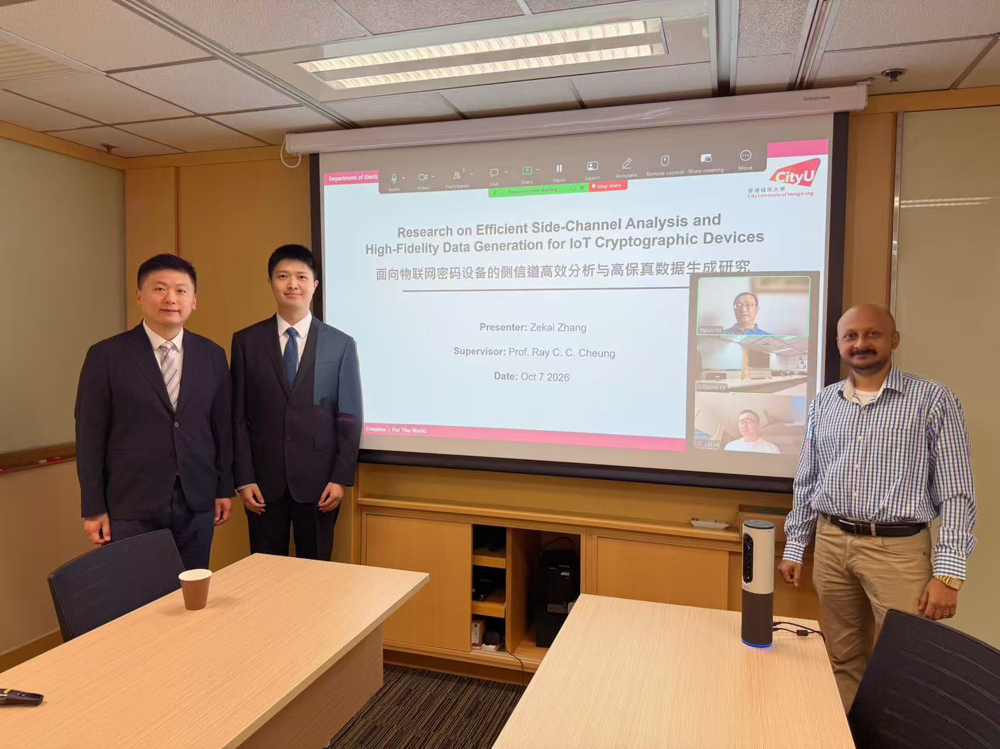
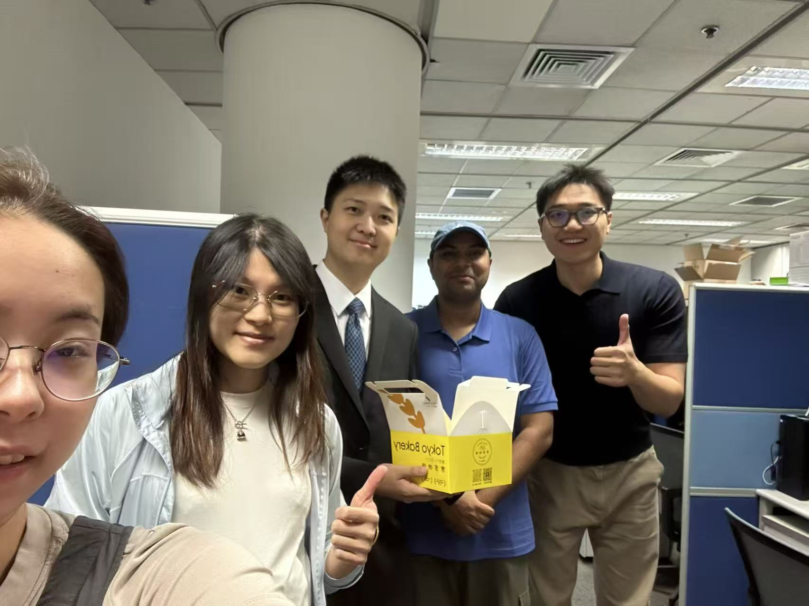
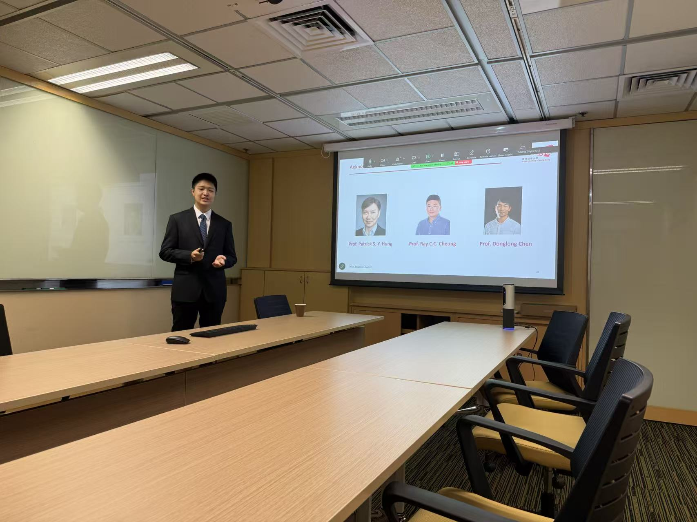
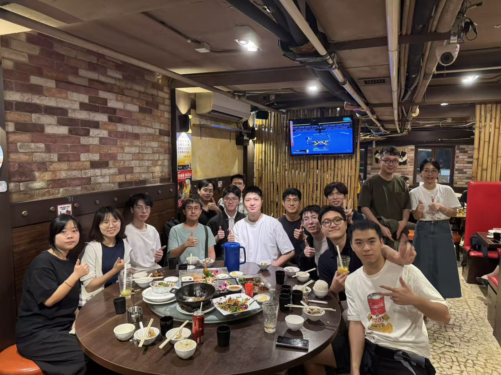

Congratulations to Jerry on successfully completing his PhD oral examination with an excellent panel of experts.

<!--more-->

  
  
  
  

Jerry's oral examination panel included three IEEE Fellows: Prof. Basu from City University of Hong Kong, Prof. Ha from Shanghai, now based in Singapore, and Prof. He from Ningbo, now based in Los Angeles.

During his PhD studies, Jerry has built an impressive research portfolio spanning hardware security, side-channel analysis, and secure processor design. His work on high-fidelity conditional side-channel trace synthesis using diffusion models and latent diffusion for efficient IoT side-channel analysis has appeared in the IEEE Sensors Journal and IEEE Internet of Things Journal. He has also contributed to lightweight RISC-V encryption and reconfigurable hardware copyright protection, with papers presented at IEEE ASAP.

Jerry's research has also led to a patent on automated side-channel security evaluation using cloud-native generative artificial intelligence. His work on the S-RISC-V lightweight secure processor architecture was recognized with a Silver Medal at the 50th International Exhibition of Inventions Geneva. These achievements reflect his strong technical depth and sustained commitment to impactful research.

We are delighted to celebrate this important milestone with Jerry and extend our sincere appreciation to the distinguished panel for their valuable time and expertise. We wish Jerry every success in the next stage of his academic and professional journey.

