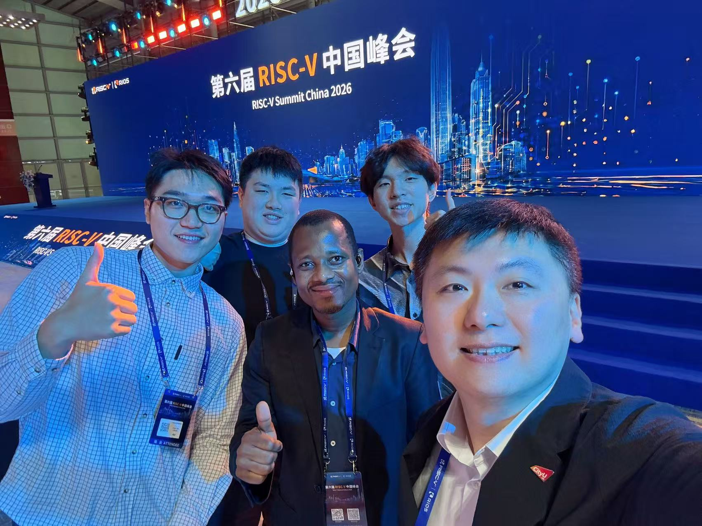
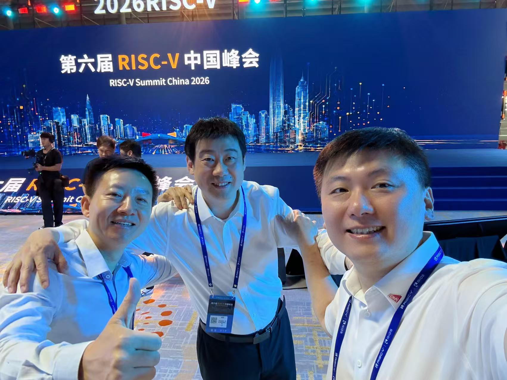
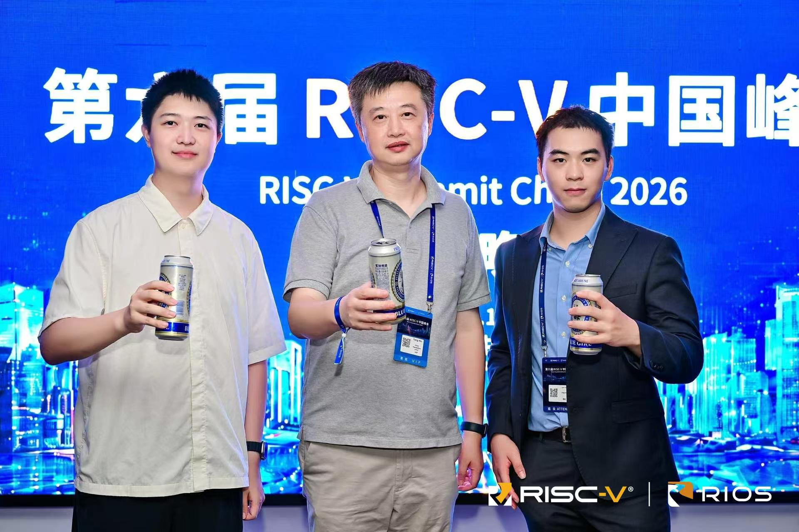
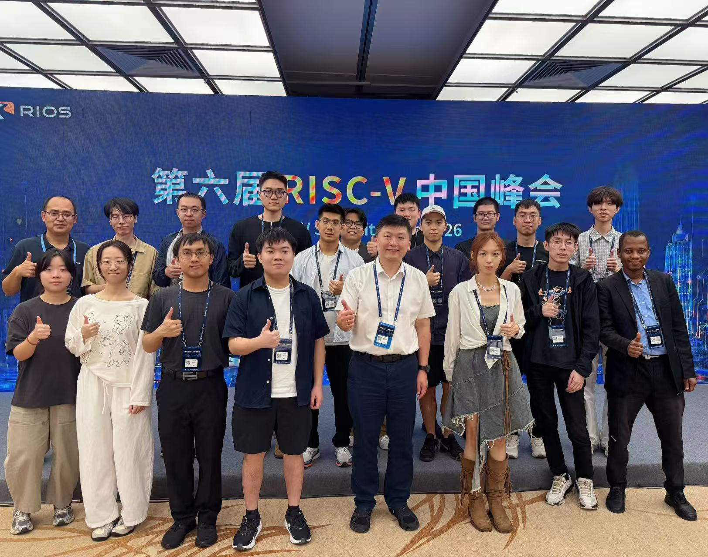
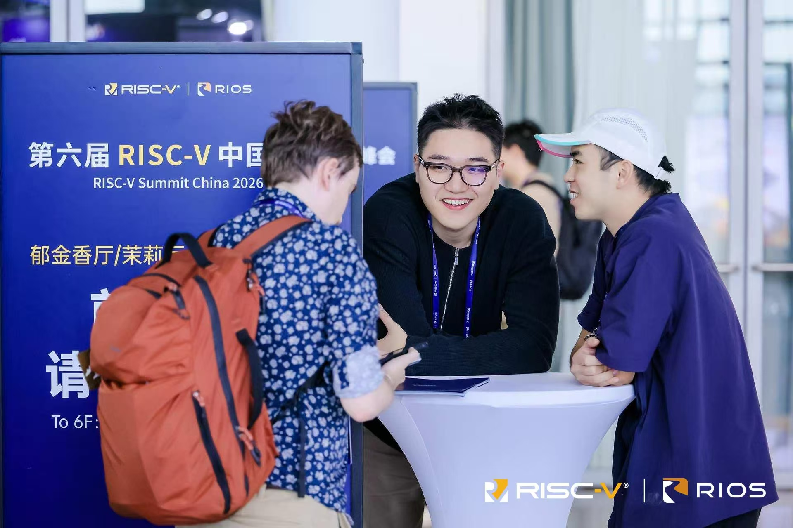
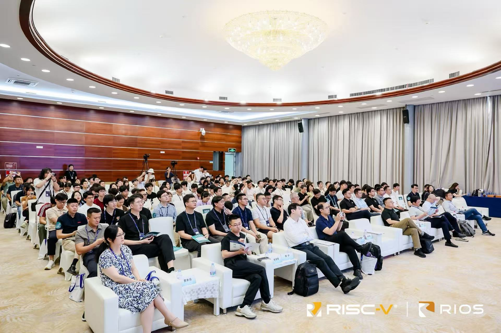

RISC-V Summit China 2026 was held from October 18 to 20 at the Shenzhen Convention & Exhibition Center (Futian), bringing together the open hardware and RISC-V community.

<!--more-->

	
	
	
	
	
	

The sixth RISC-V China Summit concluded after three days of tutorials, working meetings, the opening ceremony, and the main forum. The programme brought together discussions across AI computing, high-performance computing, software ecosystems, automotive electronics, chip design and verification, industry-academia collaboration, and embedded systems.

The summit highlighted advances across the RISC-V ecosystem and created opportunities for researchers, developers, and industry partners to exchange ideas. Its themes closely connect with CALAS's work on RISC-V processor architectures, secure and energy-efficient computing, hardware-software co-design, cryptographic hardware, and embedded IoT systems.

CALAS members participated in the summit activities and learned from the latest research, technology developments, and industrial applications presented throughout the programme. The exchanges with the RISC-V community broadened our understanding of current directions in open hardware and will inform CALAS's future research and collaboration.

For further details, please refer to the [RISC-V Summit China 2026 announcement](https://mp.weixin.qq.com/s/QX1xPUAhFIR4z7eUbae0Qw).

