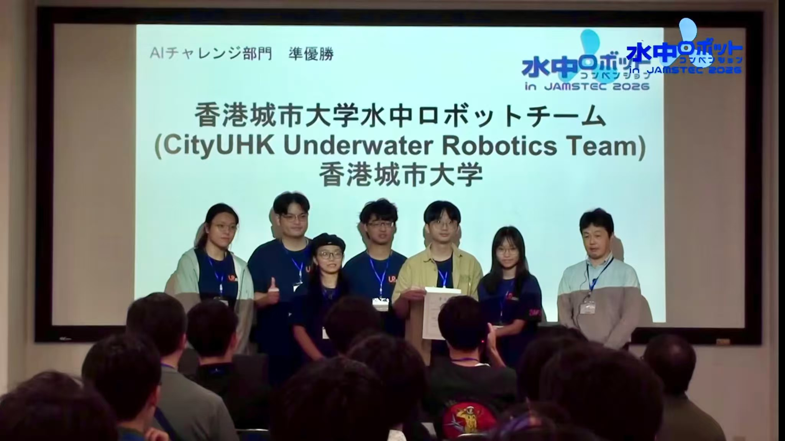
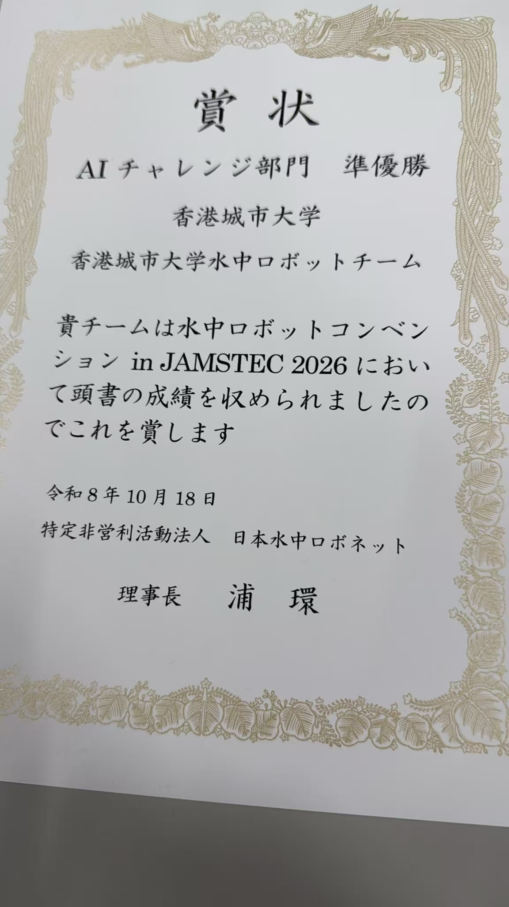

The CityUHK Underwater Robotics Team achieved first runner-up in the AI track of the JAMSTEC competition.

<!--more-->

  
  

We warmly congratulate the CityUHK Underwater Robotics Team on achieving first runner-up in the AI track of the JAMSTEC competition. The result recognises the team's commitment to developing intelligent technologies for underwater robotics and their ability to work effectively across disciplines.

JAMSTEC, the Japan Agency for Marine-Earth Science and Technology, advances ocean, Earth, and marine research through a broad range of scientific and technological programmes. Participation in this competition gave the team an opportunity to engage with a community working at the intersection of artificial intelligence, marine technology, and ocean research.

This achievement reflects the students' technical capability, creativity, and teamwork. CALAS congratulates the team on this outstanding result and looks forward to their continued contributions to underwater robotics and intelligent systems research.

For more information about JAMSTEC, visit the [JAMSTEC website](https://www.jamstec.go.jp/e/).

