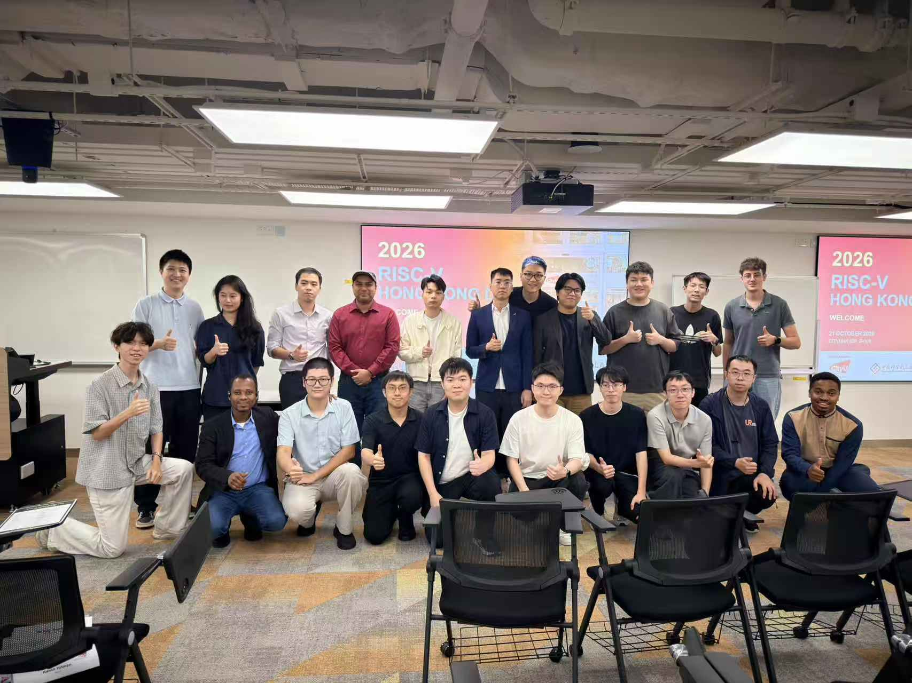
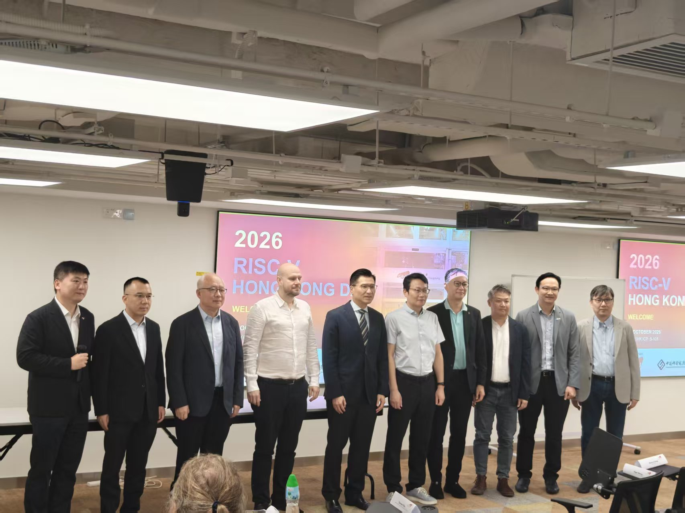
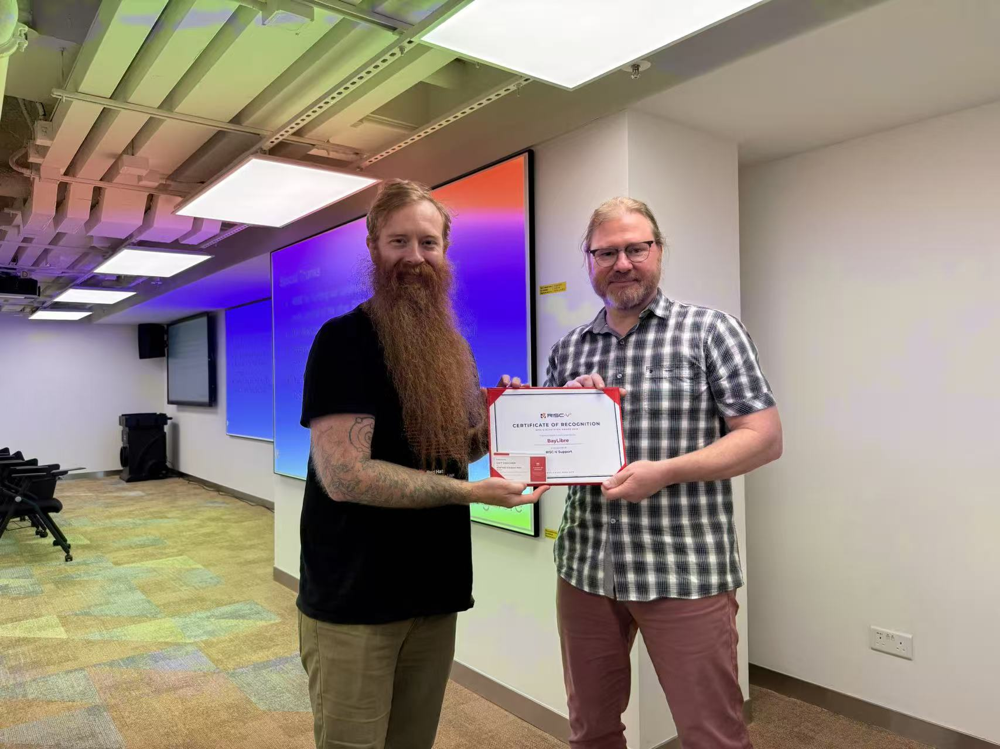
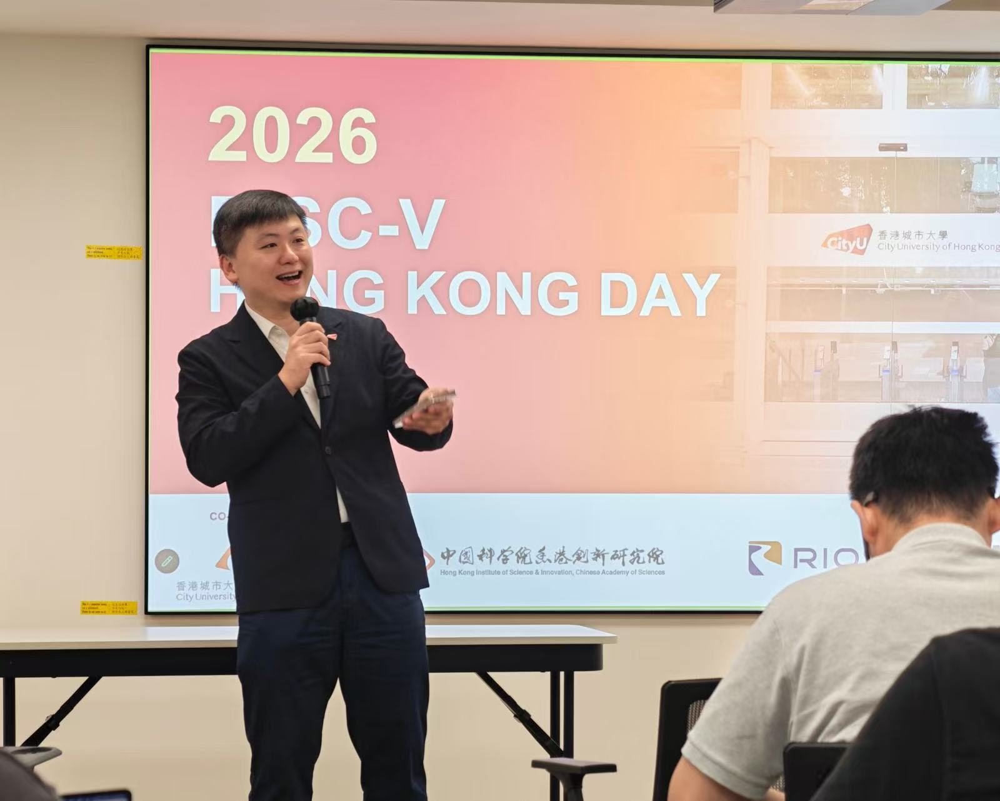
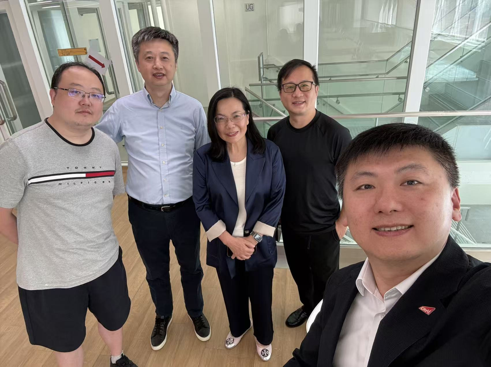
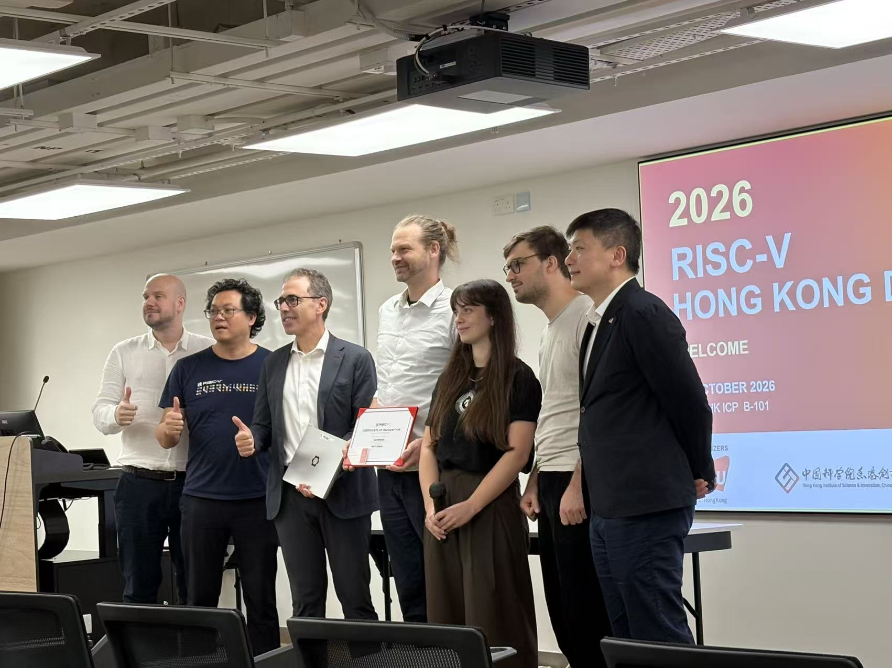

CALAS hosted RISC-V Hong Kong Day 2026 on 21 October at City University of Hong Kong's Inter-Continental Plaza, bringing together the RISC-V community for a full day of technical exchange.

<!--more-->

  
  
  
  
  
  

Organized by the CityUHK Architecture Laboratory for Arithmetic and Security (CALAS), the event convened researchers, academics, industry professionals, and members of the international RISC-V community to exchange ideas on RISC-V computing architectures and related technologies.

The programme featured a plenary address by Dr. Philipp Tomsich, TSC Vice-Chair of RISC-V International, alongside keynote presentations from representatives of Tenstorrent, RISC-V International, the Chinese Academy of Sciences, DeepComputing, Red Hat, the Linux Foundation APAC, and other leading organizations.

The full programme is available in the [RISC-V Hong Kong Day 2026 agenda (PDF)](agenda.pdf).

Held at ICP B-101, the gathering provided CityUHK faculty, research staff, students, engineers, and technology enthusiasts with opportunities to learn about developments in RISC-V, computer architecture, semiconductor technologies, and emerging computing technologies.

Across the plenary and keynote sessions, participants gained perspectives on the RISC-V ecosystem from both research and industry. The presentations connected architecture research with practical developments in open-source software, AI computing, high-performance systems, and semiconductor design, while highlighting the importance of collaboration among universities, technology companies, and the wider international RISC-V community.

For CALAS members and the CityUHK community, the event offered a valuable opportunity to engage directly with leading speakers and to follow current directions in open hardware. The discussions will support continued learning and research in processor architecture, hardware-software co-design, secure computing, and related emerging technologies.

