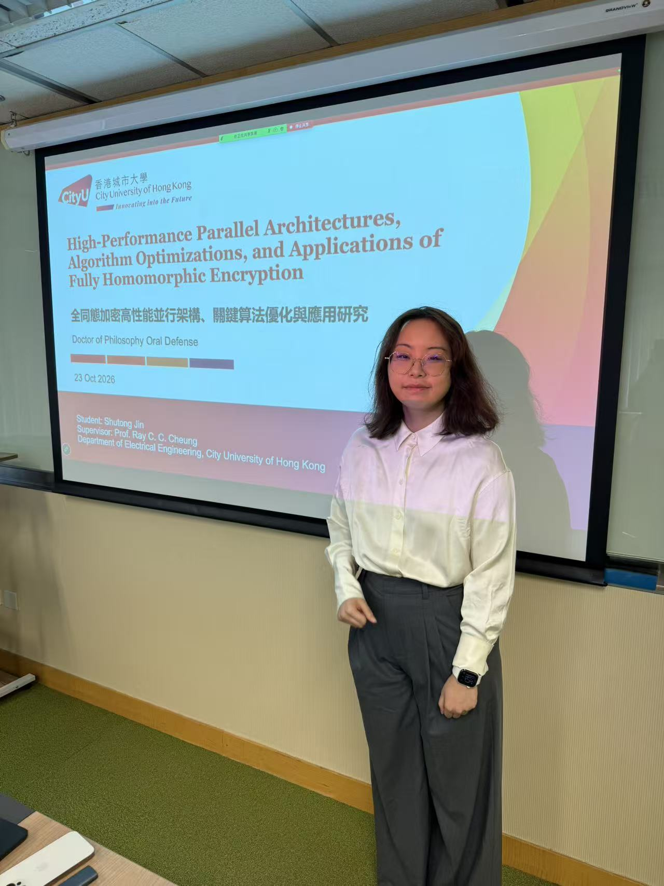
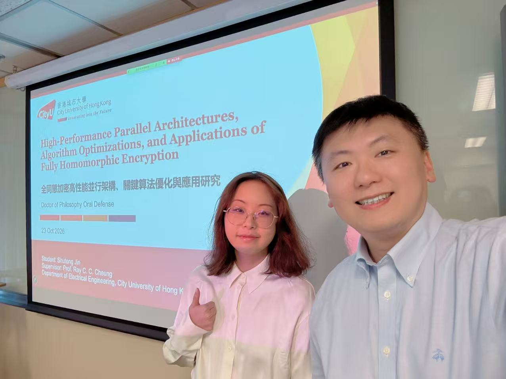
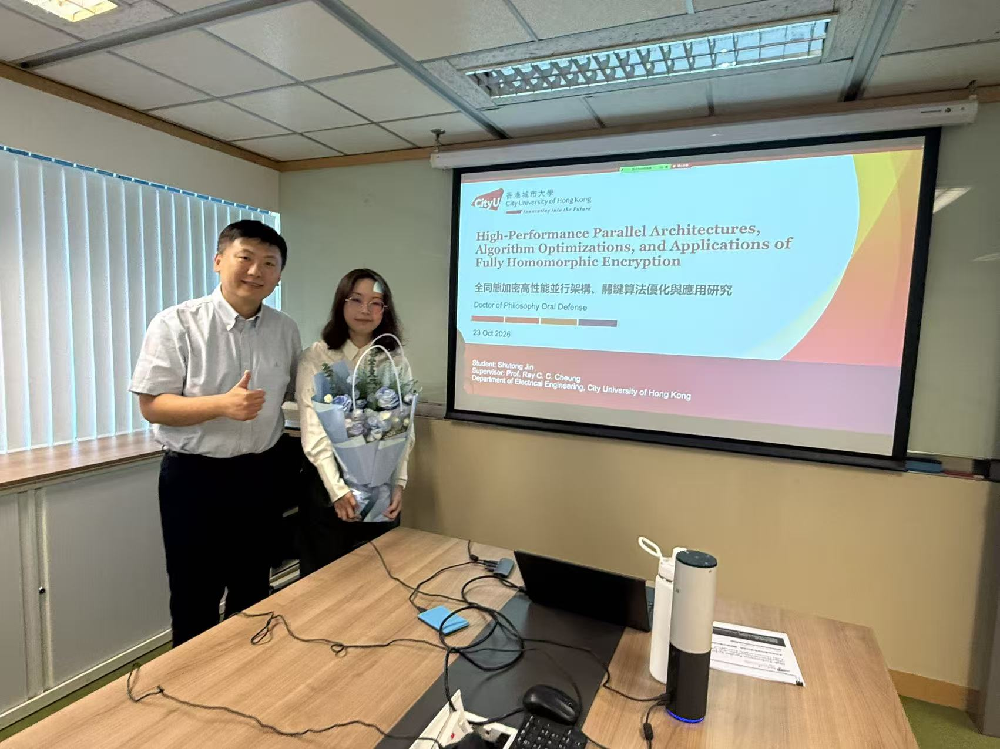
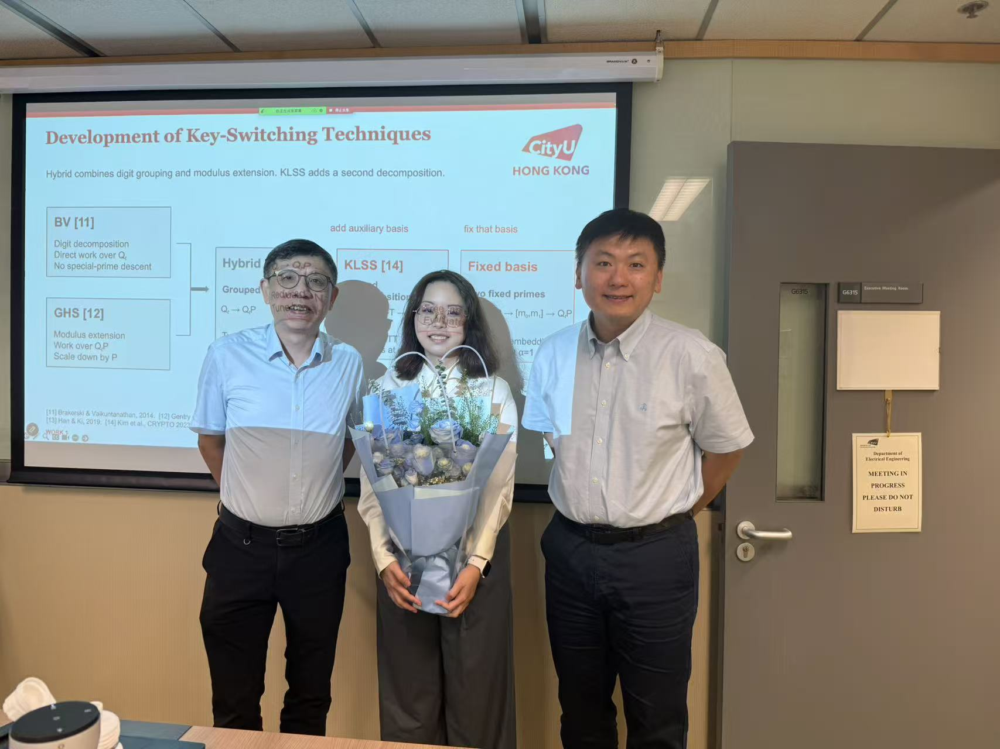
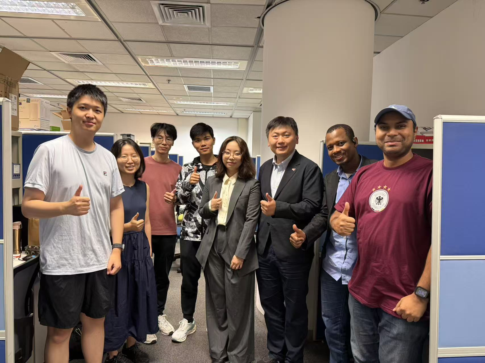

Warm congratulations to Dr. Claire JIN on successfully passing her PhD oral defence at City University of Hong Kong.

<!--more-->

  
  
  
  
  

We warmly congratulate Dr. Claire JIN on successfully passing her PhD oral defence. This important achievement marks the completion of her doctoral studies in the Department of Electrical Engineering at City University of Hong Kong under the supervision of Prof. Ray C. C. Cheung.

Claire received her B.Eng. in Electrical Engineering from City University of Hong Kong in 2020. During her PhD studies, she pursued research in deep learning and hardware acceleration of computing, developing expertise at the intersection of intelligent algorithms and efficient computing systems.

Claire is the 27th PhD graduate of CALAS and the seventh PhD graduate of 2026. We are proud of her accomplishment and wish her every success in the next stage of her academic and professional journey.

