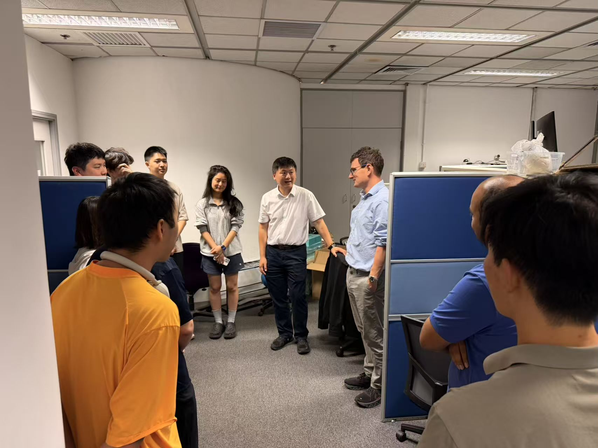

CALAS was pleased to welcome Dr. Rob Dimond from Arm UK to the lab on October 28.

<!--more-->

Dr. Robert "Rob" Dimond visited CALAS and met with members of the group. Dr. Dimond holds a PhD from Imperial College London and was previously a key leader at Maxeler. His visit offered our members an opportunity to learn from his experience in industry.

Dr. Dimond and Prof. Ray Cheung were PhD classmates at Imperial College London. We thank Dr. Dimond for visiting CALAS and sharing his time with the group.

