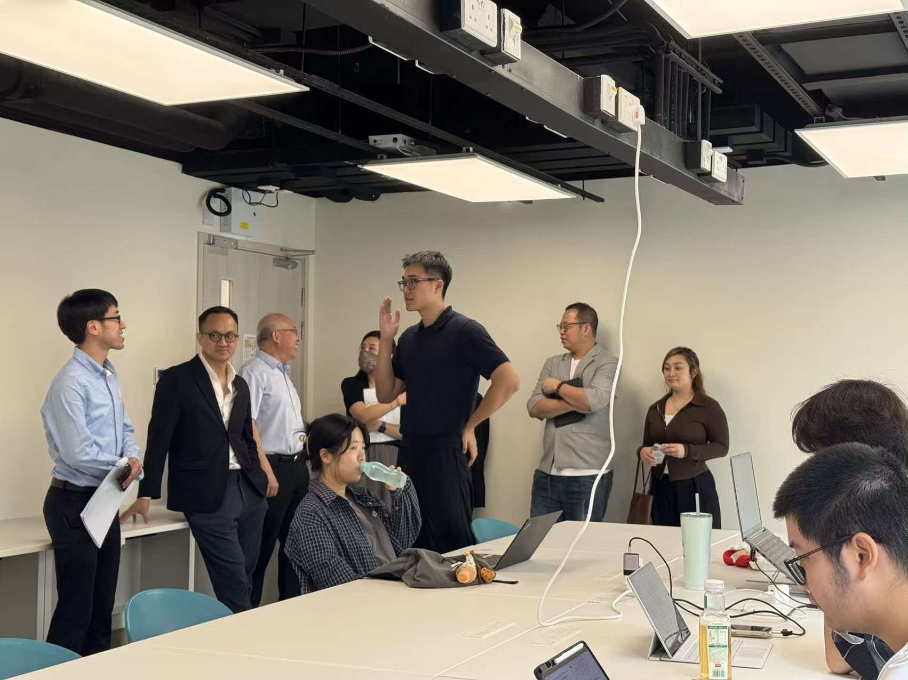
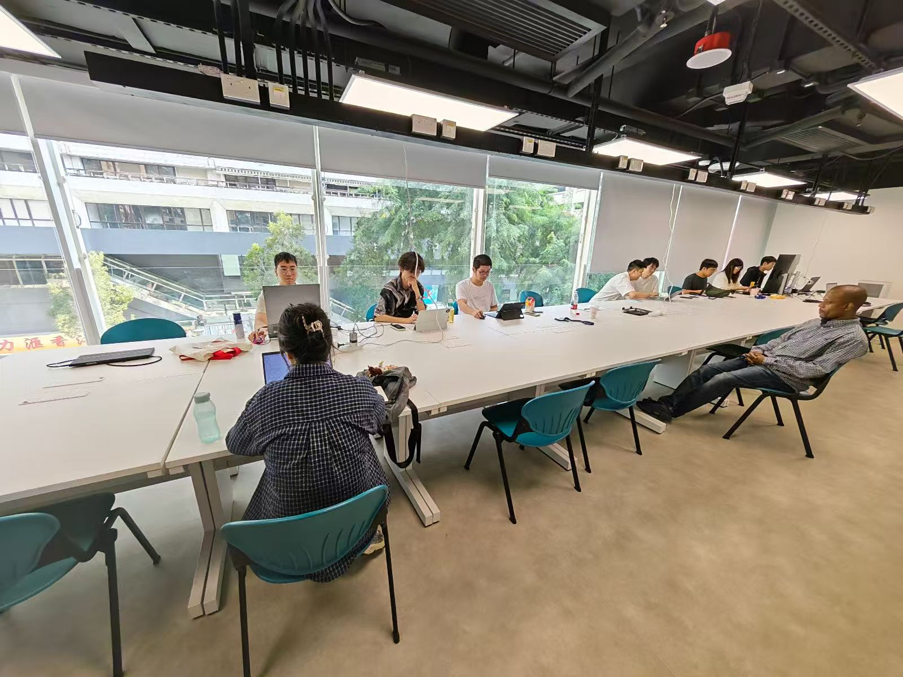

The College of Engineering (CENG) Dean's Office was scheduled to visit the CALAS lab at Intercontinental Plaza on October 30.

<!--more-->

The visit was planned for 2:00 to 4:00 pm on October 30, 2026, at Intercontinental Plaza (ICP). The planned visit also included Alan's lab.

We appreciate the opportunity to welcome colleagues from the College of Engineering to our lab.

|  |  |
|:---:|:---:|
