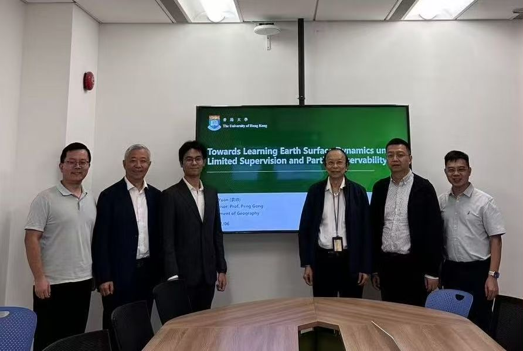

Warm congratulations to CALAS alumnus Dr. Shuai YUAN on successfully defending his PhD thesis at The University of Hong Kong!

<!--more-->

We are delighted to congratulate Dr. Shuai YUAN, who has successfully defended his PhD thesis, titled "Towards Learning Earth Surface Dynamics under Limited Supervision and Partial Observability", at The University of Hong Kong (HKU).

Shuai joined CALAS in 2021 after receiving his B.Eng. degree from the Department of Electrical Engineering at Tsinghua University, and completed his MPhil studies under the supervision of Prof. Ray C. C. Cheung in 2023. At CALAS he began his research in remote sensing, with papers accepted at IGARSS 2022, IGARSS 2023 and in Remote Sensing, before continuing to his doctoral studies at HKU.

Reflecting on his journey, Shuai shared: "It's been a lovely time at CALAS, where I started my research. I'm really grateful for your guidance and support over the years."

We are proud of Shuai's achievement and wish him every success in the next chapter of his academic and professional career.

