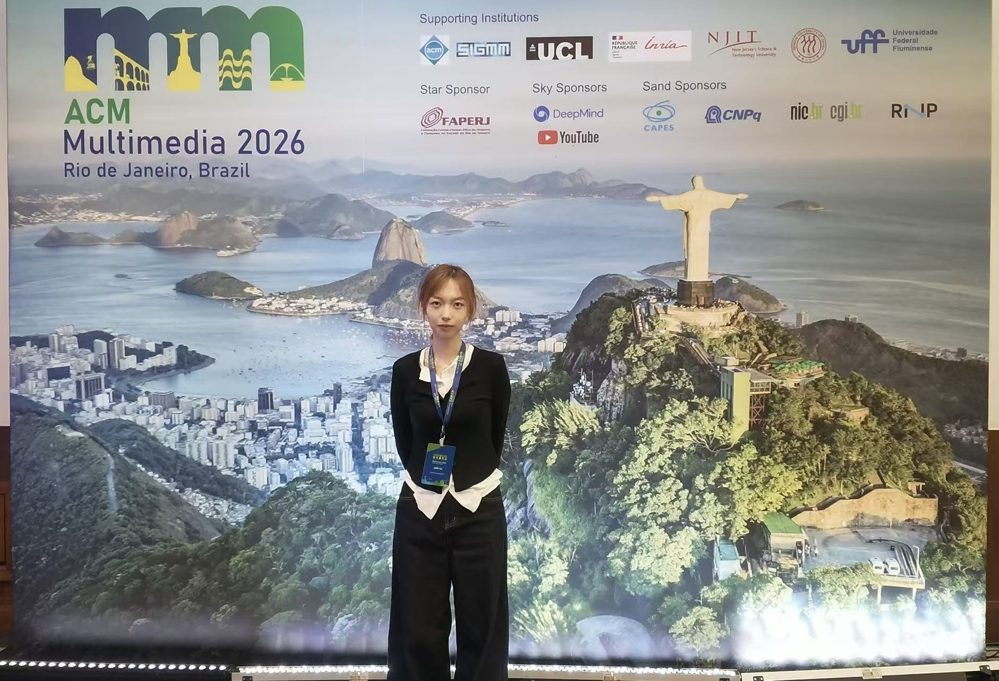

Camilla successfully presented her paper at ACM Multimedia 2026 in Rio de Janeiro, Brazil.

<!--more-->

Congratulations to Camilla LIU, Ph.D. Candidate at CALAS, who successfully presented her work at the 34th ACM International Conference on Multimedia (ACM MM 2026), held in Rio de Janeiro, Brazil, from 10 to 14 November 2026. Her main-track paper, **"Beyond Modality Harmony: Orthogonal Purification and Topology-Guided MoE for Conflict-Aware Multimodal Recommendation"**, tackles conflicts between modalities in multimodal recommendation through orthogonal purification and a topology-guided mixture-of-experts design.

ACM Multimedia is the flagship international conference of the multimedia research community. This year's main track received 7,053 submissions with an acceptance rate of around 20%, as reported when [Camilla's paper was accepted](/news/26-07-12-camilla-acm-mm-paper-accepted/) in July.

Camilla thanked Prof. Ray C. C. Cheung for his support and encouragement, describing the conference as a great experience in which she learned a lot from the talks and discussions, and a memorable and inspiring journey. Prof. Ray and all CALAS members warmly congratulate Camilla on representing CityUHK and CALAS on the international stage.

