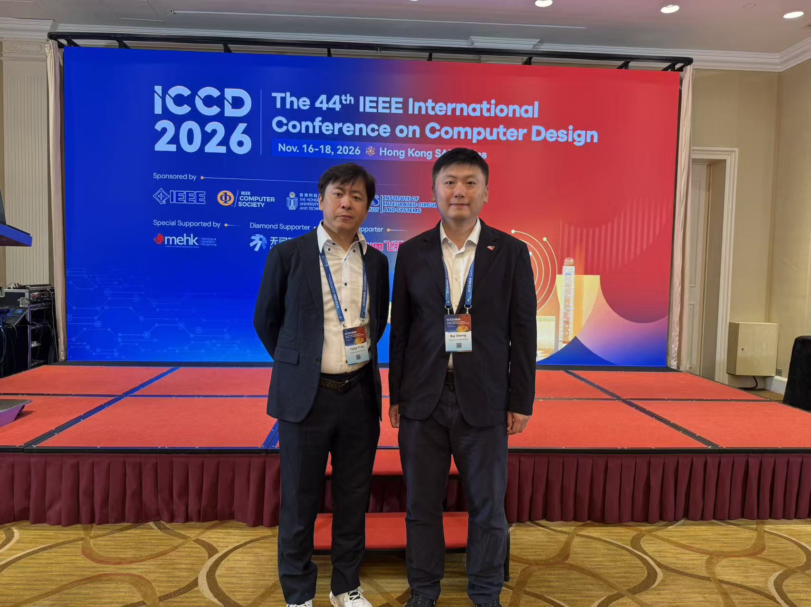
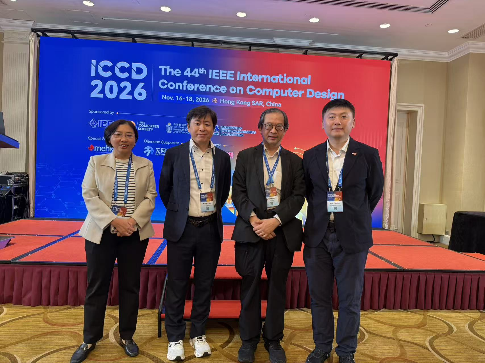
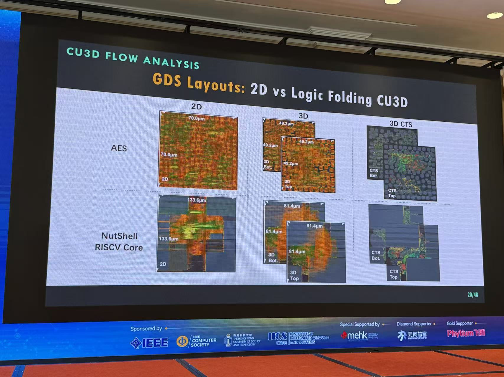
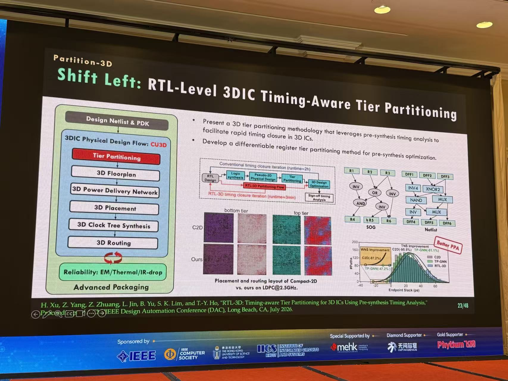

Prof. Ray C. C. Cheung chaired the keynote talk by Prof. Tsung-Yi Ho on 3D IC design at the 44th IEEE International Conference on Computer Design (ICCD 2026), held in Hong Kong.

<!--more-->

  
  
  
  

The 44th IEEE International Conference on Computer Design (ICCD 2026) took place in Hong Kong SAR, China, from 16 to 18 November 2026. Sponsored by the IEEE and the IEEE Computer Society, ICCD is a long-running international forum covering the full spectrum of computer design, from circuits and EDA to processor architecture and systems. Prof. Ray C. C. Cheung served as chair of the keynote talk delivered by Prof. Tsung-Yi Ho of The Chinese University of Hong Kong (CUHK).

Prof. Ho's keynote explored how 3D stacking can break the cost barrier of 2D scaling, and the EDA challenges of closing the design flow for logic folding. He presented the CU3D 3D IC physical design flow, covering tier partitioning, 3D floorplanning, power delivery, placement, clock tree synthesis and routing, and showed 3D IC layouts running AES and the NutShell RISC-V core. The talk also highlighted RTL-3D, a timing-aware tier partitioning method based on pre-synthesis timing analysis, presented at DAC 2026.

The conference also brought together familiar faces of the CALAS family, including Prof. Wayne Luk of Imperial College London, Prof. Ray's PhD supervisor. With more major conferences coming to Hong Kong, Prof. Ray encourages CALAS members to take up volunteer roles at these events and use them as opportunities to learn from leading researchers in the field.

