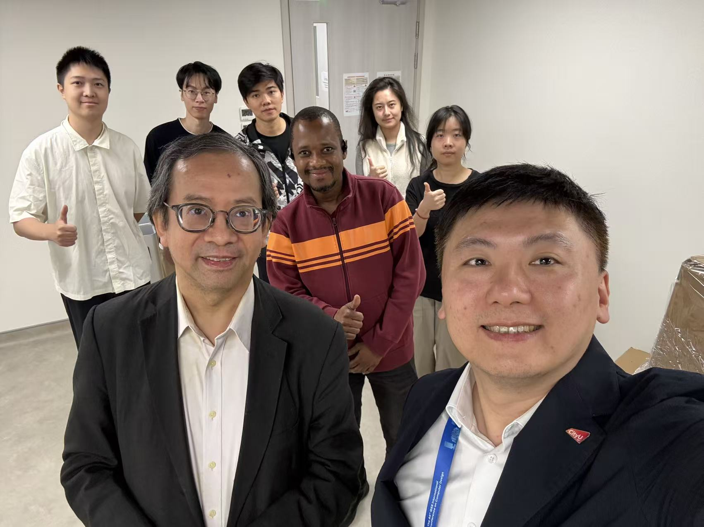
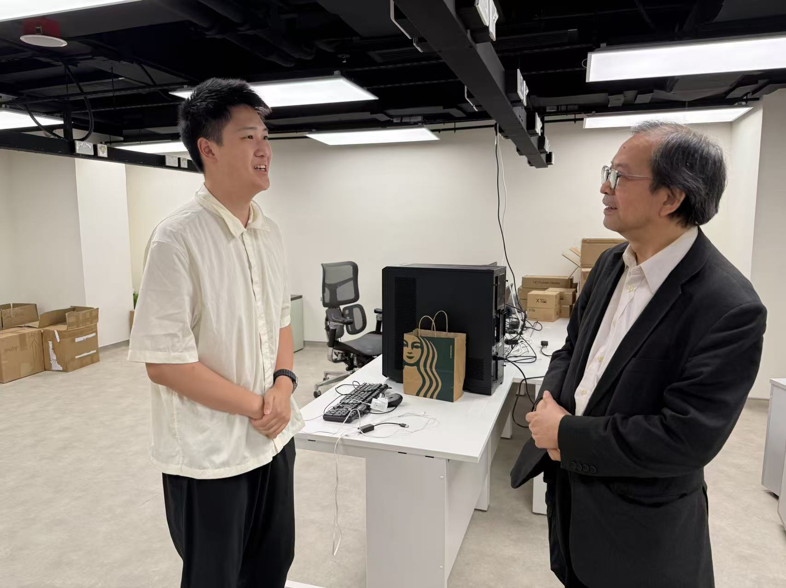
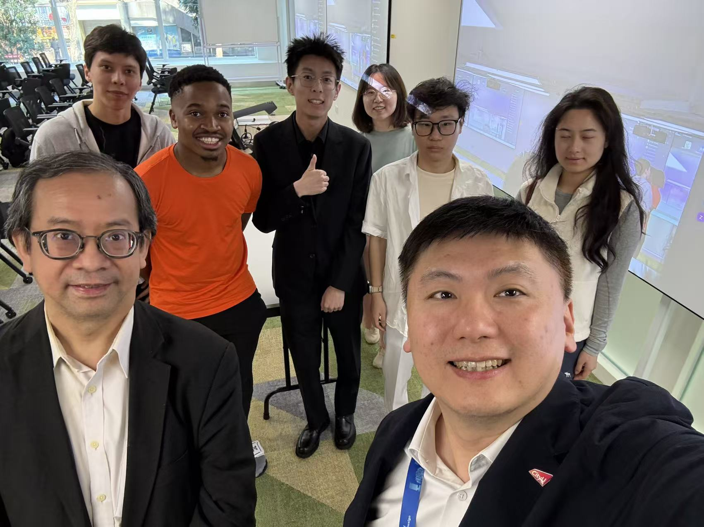
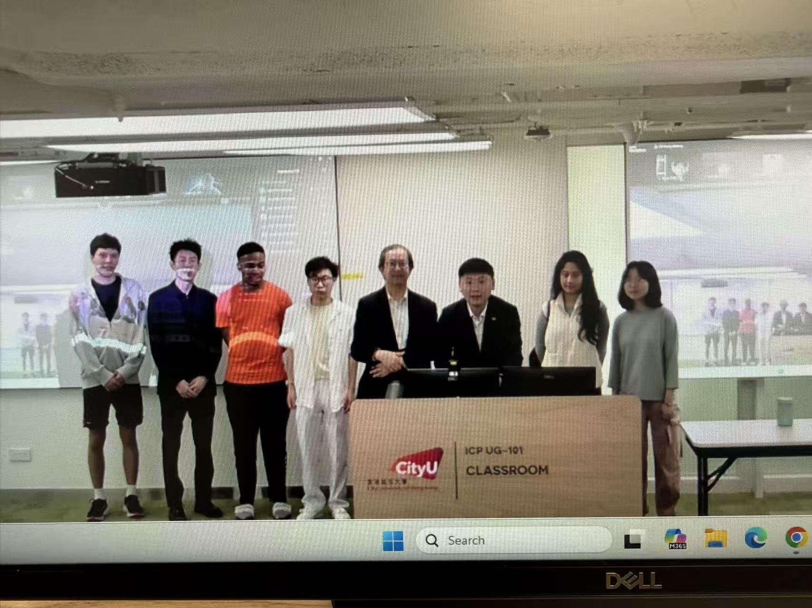

CALAS was honoured to welcome Prof. Wayne Luk of Imperial College London, Prof. Ray's PhD supervisor, who listened to our research reports and shared insights from his research career.

<!--more-->

  
  
  
  

CALAS was deeply honoured to welcome Prof. Wayne Luk, Professor of Computer Engineering at Imperial College London, to City University of Hong Kong. Prof. Luk was Prof. Ray C. C. Cheung's PhD supervisor at Imperial College, and his visit was a special occasion for the whole team, connecting CALAS with the academic roots from which it grew.

During the visit, CALAS members presented their research reports to Prof. Luk. He listened carefully and asked each of us to sum up our work in three key points, in the style of an "elevator pitch". This simple but demanding exercise pushed everyone to identify the core problem, contribution and impact of their research, and to communicate them clearly and concisely.

Prof. Luk also generously shared insights and experiences from his research life, and his encouragement left a lasting impression on all of us.

We gained a great deal from this visit, and we express our greatest gratitude to Prof. Luk for his time, his thoughtful questions and his inspiring words. We look forward to welcoming him back to CALAS again. Read about his [previous visit to CALAS in November 2024](/news/24-11-26-prof-wayne-luk/).

