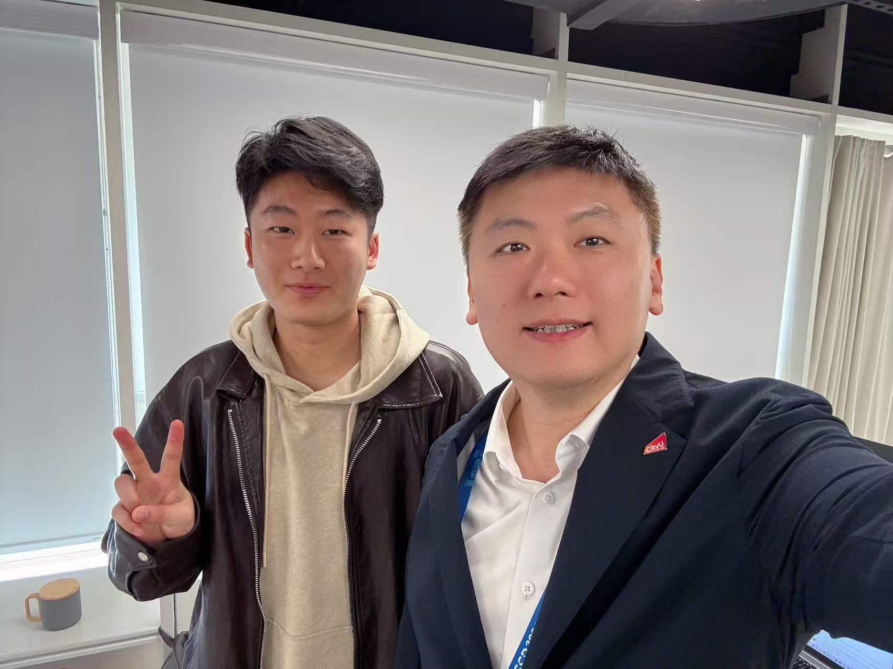
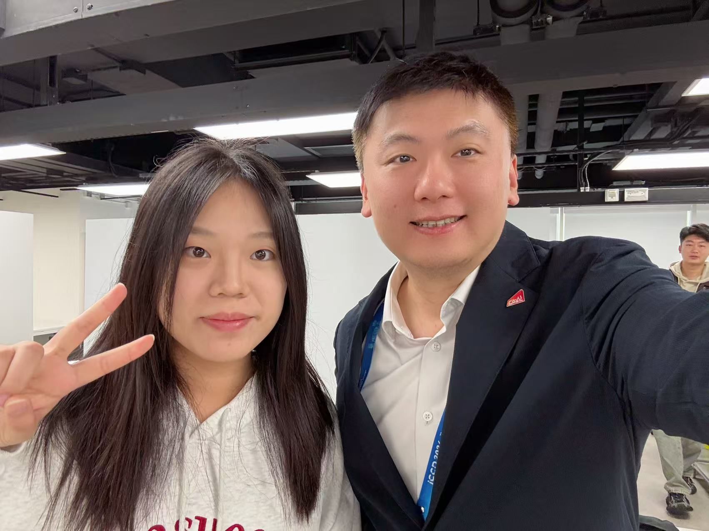
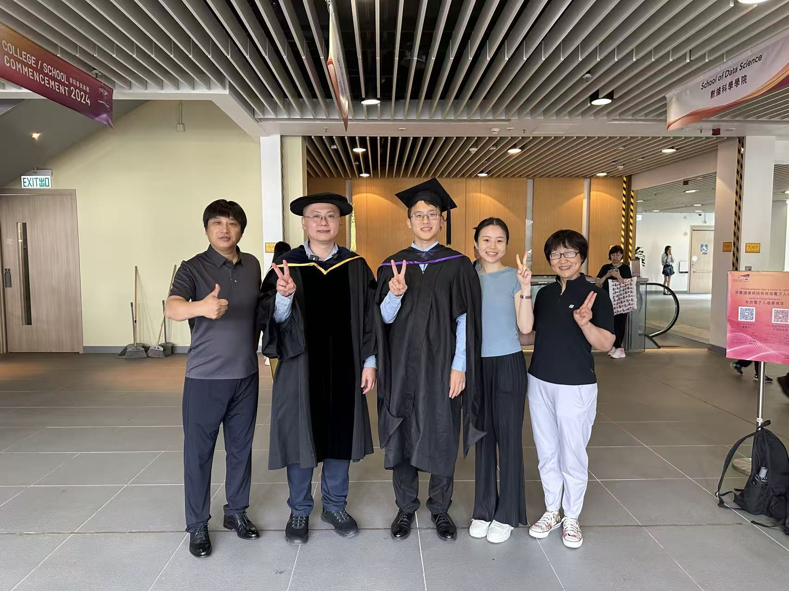

CALAS warmly welcomes four new PhD students, Lillian, Ary, Toby and Franklin, who will join the group in 2027 under the co-supervision of Prof. Ray C. C. Cheung and Prof. Alan Lam.

<!--more-->

  
  
  

We are delighted to welcome **Lillian**, **Ary**, **Toby** and **Franklin** to CALAS as our new batch of PhD students for 2027. All four will be co-supervised by **Prof. Ray C. C. Cheung** and **[Prof. Alan Lam](/author/prof.-alan-lam/)**.

Lillian graduated from the Department of Biomedical Engineering at City University of Hong Kong, and Ary graduated from The Chinese University of Hong Kong (CUHK). Toby is rejoining CALAS and is "very honoured to rejoin CALAS as a PhD student", looking forward to learning from and collaborating with everyone. Franklin is a former CALAS MSc graduate (2023) who completed a Master's dissertation under Prof. Ray's guidance and is glad to be back.

With this new batch, Prof. Ray and Prof. Alan now co-supervise a team of 12 PhD students, joining Fred, Ken, Eden, Frankie, Ash, Elvis, Judith and Raymond.

A warm welcome to Lillian, Ary, Toby and Franklin. We look forward to the work they will do with CALAS!

